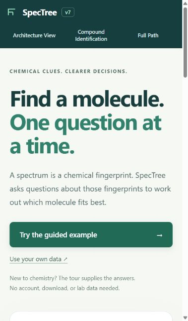

# SpecTree

**Find a molecule by asking better questions.**

SpecTree turns spectral evidence into a sequence of questions. Each answer changes which compounds fit best, and the model chooses what to ask next. You can try a guided example without knowing chemistry, answer questions using your own spectra, or explore the model's full decision tree.



## Start with the guided example

Open the website and choose **Try the guided example**. The example supplies caffeine's stored answers, so you can follow along with **Next**. Watch the questions and candidate ranking change, then see the resulting molecular structure. No account or API key is needed.

For local use, install Node.js, open a terminal in this folder, and run:

```sh
node serve.cjs
```

Open **http://127.0.0.1:8790/**. Keep the terminal open while using the viewer. You can also serve the folder with `python -m http.server 8790 --bind 127.0.0.1`.

Opening the HTML file directly will not work: the model and worker need HTTP. After the folder is downloaded, the app works locally without an internet connection; its libraries and data are included.

## What you can do

| View | What it is for |
| --- | --- |
| Guided example | Follow a complete identification with supplied answers. Start here if spectroscopy is new to you. |
| Compound Identification | Answer from your own spectra, or try another simulated example. Select an answer, click Next, and use Back to revise it. |
| Architecture View | Explore the questions, measurement techniques, model components, and compound library. |
| Full Path | Pan and zoom through the 360-degree decision tree. Expand branches or search for a compound's stored route. |

Own-data mode accepts your observations through questions. It does not import raw instrument files. The built-in measurements are simulated noisy test readings; their identity can be revealed while practicing.

## Full model, in your browser

- **105,328 compounds**, all scored after every answer.
- **645 questions** across mass spectrometry, infrared, proton NMR, and carbon NMR.
- **1,524,318 decision states** in the complete stored-reading tree.
- **106 data chunks**, loaded as needed for individual examples.
- No backend inference service, account, or secret key.

The next question is selected by information gain over the leading 256 candidates. The model stops when its leading probability reaches 99.9%, after 60 answers, or when no useful next question remains. A confidence threshold is a stopping rule, not a measured identification-accuracy claim.

The tree combines identical ordered question-and-answer histories for every compound's stored reading. Thousands of nodes are drawn at once; expanding branches reveals more. All readings stay represented even when their branches are collapsed. The tree is not every hypothetical answer sequence.

## Reproducibility and limitations

Run the release check before sharing or deploying:

```sh
node scripts/verify-release.cjs .
```

It checks every packaged file against its manifest, the model and tree hashes, all 106 chunks and 105,328 readings, and internal page links. This confirms package completeness and consistency. Browser interaction checks and scientific validation are separate.

Local browser checks on November 4, 2026 covered the guided caffeine example through all 17 answers, Back in a manual session, and the 320-pixel mobile layout. Map keyboard checks remain pending; this is not a complete accessibility audit.

The library is derived from PubChemLite. Model probabilities are not experimentally calibrated accuracy. The source compound may differ from the model's leading candidate, and a real sample may be absent from the library. IR examples are categorical band observations rather than a continuous FTIR spectrum; NMR plots show signal centers with tables of the supplied details.

## For developers

The release is plain HTML, CSS, and JavaScript. [Cytoscape.js](https://js.cytoscape.org/) draws the maps; [SmilesDrawer](https://github.com/reymond-group/smilesDrawer) draws molecular structures. Web Workers run identification and trace calculations. There is no install or build step for this prepared release.

- [Architecture and source map](docs/ARCHITECTURE.md)
- [Data provenance and limits](docs/DATA.md)
- [Third-party notices](docs/THIRD_PARTY.md)
- [Publishing and launch notes](docs/LAUNCH.md)

The included **Publish SpecTree** workflow runs only when manually started. Configure GitHub Pages to use **GitHub Actions**, then run the workflow after reviewing the release. See [GitHub's custom Pages workflow guide](https://docs.github.com/en/pages/getting-started-with-github-pages/using-custom-workflows-with-github-pages).

Built by Gavin Moore. See the third-party notices before redistributing included code or data; this repository does not grant a blanket license over the complete data collection.
