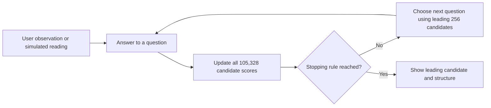

# How SpecTree works

The user answers a spectral question. SpecTree updates the probability of every compound, chooses the most informative next question from its question bank, and repeats.

## Source map

| File | Responsibility |
| --- | --- |
| `v7_map/index.html`, `home.js`, `home.css` | Entry screen and legacy URL routing |
| `v7_map/identification.html`, `identification.js` | Interactive own-data, synthetic, and guided sessions |
| `v7_map/identification-worker.js` | Loads and checks the model, holds session history, applies answers, and replays revisions |
| `v7_map/engine.js` | Canonical v7 scoring, question selection, ranking, and stopping rules |
| `v7_map/architecture.html`, `app.js`, `network-layout.js` | Cytoscape.js model network and recorded trace inspector |
| `v7_map/trace-worker.js` | Calculates a full recorded-reading trace |
| `v7_map/paths.html`, `paths-page.js`, `path-tree.js` | Loads the audited tree and draws a bounded radial view |
| `v7_map/molecule-card.js` | Supplied compound names and local SMILES structure rendering |
| `v7_map/data/` | Model, library, and audited path tree |
| `akinator_v7/molecules/` | Stored simulated readings and source peak data in 106 chunks |

## Scoring and stopping

The engine starts with a uniform prior over the complete library. Each answer adds a technique-weighted log likelihood from the learned confusion model. The model selects the next question by information gain over the top 256 candidates, with its existing technique weights and routing settings. All 105,328 candidates remain scored.

The model stops at leading probability ≥ 0.999, 60 answered questions, or no question above the useful-information threshold. Users may also request the current result early. Going Back rebuilds the session from retained answers; a revised answer can lead to a different next question.

## Tree semantics

Every state represents an exact ordered history. Two different histories that happen to ask the same next question remain distinct states. The complete exported tree covers the all-techniques setting and every compound's stored draw-0 reading. Individual traces can also use NMR + MS.

The initial tree draws 4,500 states, with bounded expansion. A collapsed node includes all its descendants in its reading count. Edge thickness counts readings sharing a history, not eliminated or surviving candidate counts. The radial position is a viewing layout and does not represent chemical similarity.
